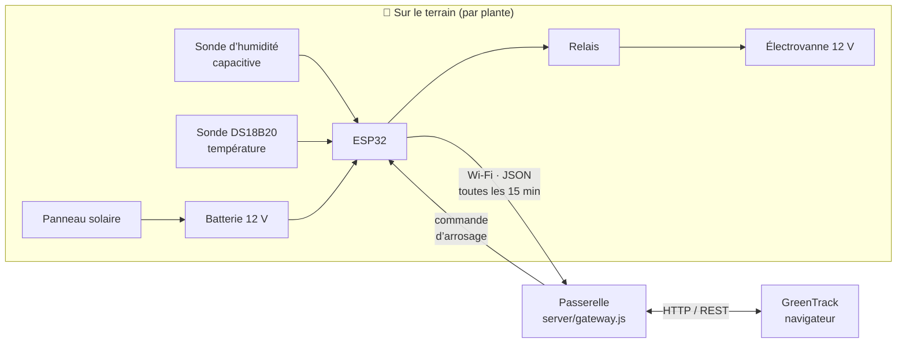
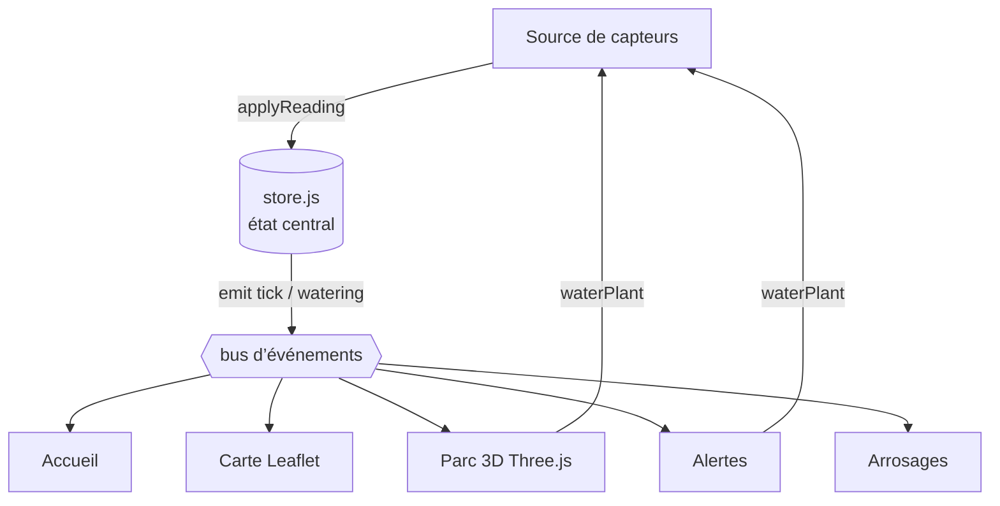

# 🏗️ Architecture de GreenTrack

## Vue d’ensemble



## Principe clé : une seule interface pour toutes les sources

Le tableau de bord ignore d’où viennent les données. [src/core/sensors.js](../src/core/sensors.js) définit un contrat minimal :

```js
source.start()                // commencer à recevoir des mesures
source.stop()
source.water(plantId, litres) // ouvrir la vanne
// … et chaque mesure passe par applyReading(sensorId, mesure)
```

| Source | Usage |
|---|---|
| `SimulatedSource` | Démonstration : climat jour/nuit, évapotranspiration par espèce, averses aléatoires |
| `GatewaySource` | Production : interroge la passerelle reliée aux vrais ESP32 |

👉 **Passer du prototype au réel ne demande aucune modification de l’interface.** On bascule simplement la source dans *Réglages → Capteurs & connexion*.

## Flux de données dans le navigateur



Toutes les vues lisent **le même état**. Un arrosage déclenché dans la 3D apparaît donc instantanément dans les alertes, la carte et l’accueil, et inversement.

## Organisation du code

```
src/
├── main.js            routeur (#/accueil, #/carte…), navigation, guide de prise en main
├── styles.css         design system (couleurs, cartes, badges, responsive)
├── ui.js              composants HTML : jauge, badges, sparkline, icônes SVG
├── charts.js          Chart.js réduit aux modules utilisés
├── core/
│   ├── thirst.js      ⭐ indice de soif et recommandation
│   ├── store.js       état, alertes, statistiques, historique des arrosages
│   └── sensors.js     sources IoT, mode autonome
├── data/              espèces, sites, registre simulé (déterministe)
├── twin/builders.js   arbres et décor 3D procéduraux (aucun fichier 3D)
└── views/             un fichier par écran, chargé à la demande
server/gateway.js      passerelle Node.js, zéro dépendance
firmware/              ESP32 (production) et Arduino Uno (Tinkercad)
```

## API de la passerelle

| Méthode | Route | Appelée par | Rôle |
|---|---|---|---|
| `POST` | `/api/readings` | ESP32 | Envoie une mesure (ou un tableau) |
| `GET` | `/api/readings` | GreenTrack | Dernière mesure de chaque capteur (moins de 6 h) |
| `POST` | `/api/water` | GreenTrack | `{ sensorId, liters }` met une commande en file |
| `GET` | `/api/commands/:sensorId` | ESP32 | Récupère sa commande (`{ water: 30 }` ou `{}`) |
| `GET` | `/health` | supervision | État de la passerelle |

## Pensé pour les connexions limitées

| Technique | Effet |
|---|---|
| Chargement à la demande des vues | Le premier écran pèse environ 16 Ko gzip |
| Leaflet et Three.js isolés | Téléchargés seulement à l’ouverture de la carte ou de la 3D |
| Graphiques chargés à l’ouverture de « Statistiques détaillées » | Pas de Chart.js sur l’accueil |
| Service worker | Application et tuiles de carte disponibles hors ligne |
| Mode économie de données | Pas de fond de carte, 3D sans ombres à 30 i/s, rafraîchissement ralenti |
| 3D procédurale | 0 octet de modèles 3D à télécharger |

## Persistance locale

| Clé `localStorage` | Contenu |
|---|---|
| `greentrack.species.v1` | Profils d’espèces modifiés |
| `greentrack.settings.v2` | Mode autonome, économie de données, source, adresse de la passerelle |
| `greentrack.waterings.v1` | Historique des 400 derniers arrosages |
| `greentrack.guide` | Guide de prise en main déjà vu |
