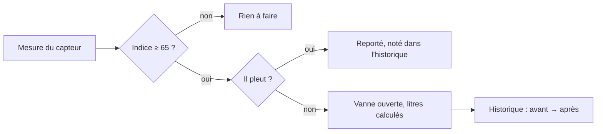

# 💧 L’indice de soif, expliqué simplement

L’indice de soif est le cœur de GreenTrack. C’est **une note de 0 à 100, propre à chaque plante**, qui répond à une seule question : *cette plante a-t-elle besoin d’eau, maintenant ?*

| Indice | Couleur | Recommandation |
|---|---|---|
| 0 – 34 | 🟢 Vert | **Aucune intervention** |
| 35 – 64 | 🟠 Orange | **Surveillance** : le sol s’assèche |
| 65 – 100 | 🔴 Rouge | **Arrosage nécessaire**, avec le nombre de litres conseillé |

## Pourquoi pas juste « l’humidité du sol » ?

Parce que **chaque espèce a des besoins différents**.

```
Humidité mesurée : 18 %

  Baobab   ─ optimum 16 % ─►  indice   0  🟢  « tout va bien »
  Neem     ─ optimum 22 % ─►  indice  30  🟢
  Cocotier ─ optimum 30 % ─►  indice  71  🔴  « a soif ! »
```

Le baobab stocke l’eau dans son tronc ; le cocotier du littoral a besoin d’un sol toujours frais. Une même mesure ne veut donc pas dire la même chose pour les deux.

## Les 3 seuils d’une espèce

Chaque espèce possède trois seuils, réglables dans l’écran **Espèces** :

```
 humidité du sol (%)
 0 ──────┬──────────┬────────────┬─────────► 45
         │          │            │
   flétrissement   stress      optimum
   (dommages)    (souffre)   (parfait)
```

| Espèce | Flétrissement | Stress | Optimum | Besoin adulte |
|---|---|---|---|---|
| Baobab | 5 % | 9 % | 16 % | 40 L/j |
| Karité | 6 % | 11 % | 18 % | 20 L/j |
| Acacia auriculé | 7 % | 12 % | 20 % | 18 L/j |
| Neem | 8 % | 14 % | 22 % | 25 L/j |
| Manguier | 9 % | 15 % | 24 % | 35 L/j |
| Flamboyant | 10 % | 17 % | 26 % | 30 L/j |
| Cocotier | 13 % | 21 % | 30 % | 45 L/j |

> ⚠️ Ces valeurs sont **indicatives** et doivent être validées par les agronomes de l’ANAP.

## La formule

```
base   = (optimum − humidité) / (optimum − flétrissement)    borné entre 0 et 1
climat = 1 + (température − 28 °C) × 0,03 × Kc               borné entre 0,85 et 1,35
âge    = 1,2 si moins de 3 ans · 1,1 si moins de 6 ans · sinon 1

indice = base × climat × âge × 100                           borné entre 0 et 100
```

- **base** : à quelle distance la plante se trouve de son optimum, sur une échelle qui va de « parfait » à « flétri ».
- **climat** : quand il fait chaud, la plante transpire plus. Le coefficient cultural **Kc** dit à quel point l’espèce y est sensible.
- **âge** : un jeune plant a des racines courtes et souffre plus vite.

### Exemple détaillé

Un cocotier de 2 ans, sol à 20 %, 34 °C :

```
base   = (30 − 20) / (30 − 13)          = 0,59
climat = 1 + (34 − 28) × 0,03 × 0,95    = 1,17
âge    = 1,2                            (moins de 3 ans)

indice = 0,59 × 1,17 × 1,2 × 100        = 83   →   🔴 Arrosage nécessaire
```

## Combien d’eau apporter ?

```
litres = besoin_adulte × déficit × taille × climat × 1,5
         (taille = 0,25 + âge / 12, borné entre 0,25 et 1,2)
```

On apporte juste ce qu’il faut pour ramener le sol à l’optimum : ni plus, ni moins.

## Et en mode autonome ?



Le code se trouve dans [src/core/thirst.js](../src/core/thirst.js) (moins de 80 lignes).
